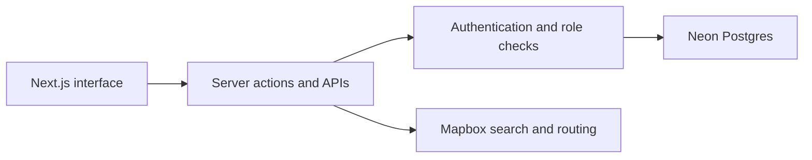

# Tripping

**Plan a trip together—from the first destination idea to a shared itinerary.**

Tripping is a collaborative travel-planning application that puts group decisions, locations, logistics, and daily plans in one workspace instead of scattering them across chats, maps, and spreadsheets.

[**Explore the live application**](https://tripping-azure.vercel.app) (sign-in required) · [View the repository](https://github.com/Nick-D-Hanson/Tripping)

**Project type:** Full-stack product | **Stack:** Next.js, TypeScript, Neon Postgres/Auth, Mapbox, Vercel

## The problem and approach

Coordinating travel with multiple people involves competing itineraries, maps, reservations, and ideas. Tripping combines these into a shared experience with clear roles and a single view of the trip.

The core product decision is to keep trip data connected: a location found through search can become an activity, appear on the map, and be organized into the trip timeline.

## What the application does

- **Collaborative planning:** Manage trip members with owner, editor, and viewer roles.
- **Visual itinerary:** Organize travel, stays, activities, and food into a day-by-day timeline with an interactive map.
- **Location and routing:** Search for places, view routes, and fall back to straight-line geometry if a routing provider fails.
- **Group decisions:** Collect ideas and links, manage packing lists, and vote on candidate activities.
- **Practical safeguards:** Validate changes server-side and restrict mutations to authorized members.

## Engineering at a glance



**Notable tradeoffs:** Permissions are enforced on the server, not only in the UI. Route-provider failures degrade gracefully. A process-local rate limiter is used for selected paths; distributed enforcement and authenticated end-to-end coverage are future hardening work.

## Quality and current status

The application is deployed to Vercel. GitHub Actions runs linting, TypeScript checks, and 12 unit tests covering permissions and utilities. These checks validate selected code behavior but do not replace authenticated browser and integration tests.

There is no claim of comprehensive integration or browser-test coverage. A future milestone is a dedicated test database and verified authenticated end-to-end scenarios.

## Run locally

Requires Node.js 22, a Neon database/Auth project, and Mapbox keys. Copy `.env.example` to `.env.local`, supply your own configuration, and never commit credentials.

```bash
npm ci
npm run db:migrate
npm run dev
```

Run quality checks with:

```bash
npm run lint
npm run typecheck
npm test
```

The [database migrations](db/migrations), [source code](src/), and [GitHub Actions workflow](.github/workflows/ci.yml) provide more technical detail. Production deployment configuration and authentication callbacks must be set up separately.

## Next improvements

Add authenticated integration tests for invitations, role-sensitive edits, and routing failures; document architecture with real screenshots; then make application behavior and deployment consistency observable through release checks.
