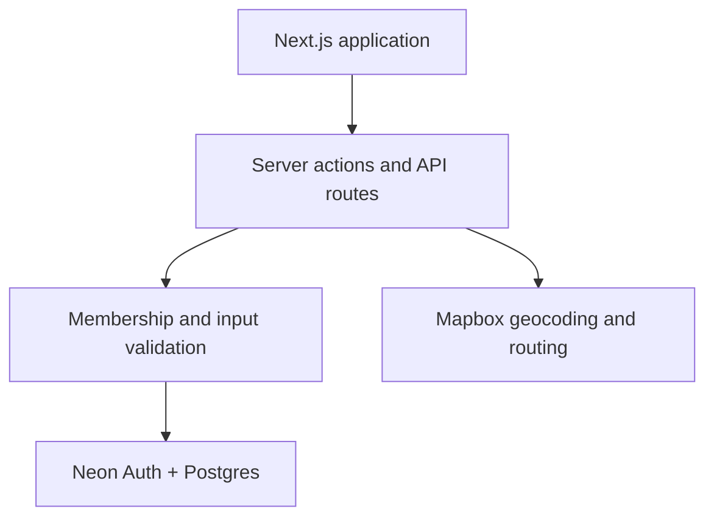

# Tripping

**One shared workspace for turning travel ideas into an actual itinerary.**

Tripping is a collaborative trip-planning product built with Next.js App Router, TypeScript, Neon Postgres, Neon Auth, Mapbox GL JS, and Vercel. It brings travelers, routes, stays, food ideas, and plans into one place.

[**Open the live application**](https://tripping-azure.vercel.app) (sign-in required)

## The engineering problem

Group travel planning often gets spread across maps, messages, notes, and spreadsheets. Tripping explores how to combine those workflows while preserving clear member permissions, consistent trip state, and graceful behavior when external map services fail.

### Architecture at a glance



Authentication, authorization, and database access stay server-side. Browser-visible Mapbox configuration is separate from the server routing token.

## Features

- Neon Auth login/signup with protected app routes
- Trip dashboard, creation, editing, deletion, and detail pages
- Collaborator management with `owner`, `editor`, and `viewer` roles
- Server-side permission checks for all mutations and route APIs
- Travel segments, lodging, and activities with create/edit/delete controls
- Mapbox map with distinct travel, lodging, and activity markers
- Mapbox Directions for drive/walk segments, Optimization for selected activities, and straight-line fallback
- Unified chronological timeline grouped by day
- Planning surfaces for food, packing, idea buckets, trip links, and item voting
- Audit events and request-level observability for selected changes

## Verification and current boundaries

```bash
npm ci
npm run lint
npm run typecheck
npm test
```

The unit tests cover trip-role policy, in-memory rate limiting, formatting, and request metadata. GitHub Actions runs those checks for proposed changes.

The app uses real Neon and Mapbox services; authenticated end-to-end tests and production-like integration environments are a future milestone. The in-memory rate limiter is process-local, not a distributed production rate-limit service.

## Local Development

1. Install dependencies:

```bash
npm ci
```

2. Copy the provided example environment file:

```bash
cp .env.example .env.local
```

3. Fill in:

```bash
DATABASE_URL=
NEON_AUTH_BASE_URL=
NEXT_PUBLIC_AUTH_URL=/api/auth
NEXT_PUBLIC_MAPBOX_TOKEN=
MAPBOX_SECRET_TOKEN=
NEXT_PUBLIC_APP_URL=http://localhost:3000
```

4. Apply the migration in your Neon SQL editor, or run Drizzle after `DATABASE_URL` is set:

```bash
npm run db:migrate
```

5. Start the app:

```bash
npm run dev
```

Open [http://localhost:3000](http://localhost:3000).

## Neon Database Setup

1. Create a Neon project and copy the pooled or direct Postgres connection string into `DATABASE_URL`.
2. Run `db/migrations/0001_init.sql`.
3. The app stores auth user IDs as text fields so it can work with Neon Auth while avoiding brittle assumptions about internal auth table names.

The schema includes:

- `trips`
- `trip_members`
- `travel_segments`
- `lodging`
- `activities`

## Neon Auth Setup

1. Enable Neon Auth for the Neon project.
2. Add the local app URL to the allowed origins/callback URLs in Neon Auth.
3. Set `NEON_AUTH_BASE_URL` to your Neon Auth endpoint.
4. Keep `NEXT_PUBLIC_AUTH_URL=/api/auth` for the local proxy route.

This MVP uses the currently installed `@neondatabase/auth` Next.js helpers:

- `authApiHandler()` mounted at `/api/auth/[...path]`
- `neonAuthMiddleware()` for `/trips/*`
- `neonAuth()` for server-side session reads
- `@neondatabase/auth-ui` for login/signup and user menu UI

## Mapbox Setup

1. Create a Mapbox account and token.
2. Set `NEXT_PUBLIC_MAPBOX_TOKEN` for Mapbox GL JS.
3. Set `MAPBOX_SECRET_TOKEN` for Directions/Optimization API calls. For local MVP testing, a public token with the right scopes can also work.

Travel segment behavior:

- Segment type selection is intentionally limited to Drive and Flight for the MVP.
- Start and end addresses are searched through Mapbox geocoding.
- Latitude and longitude are derived by the app and stored behind the scenes for maps and routes.

Routing behavior:

- Drive travel segments call Mapbox Directions.
- Flight travel segments fall back to point-to-point lines.
- Activities with `include_in_route = true` are sent to Mapbox Optimization when there are at least two stops.
- Failed routing calls gracefully return straight-line geometry.

## Vercel Deployment

1. Push the repository to GitHub.
2. Import it into Vercel.
3. Add the same environment variables in the Vercel project settings.
4. Add your Vercel production URL and preview URLs to Neon Auth allowed origins/callback URLs.
5. Deploy.

## Useful Commands

```bash
npm run dev
npm run lint
npm run typecheck
npm test
npm run build
npm run db:migrate
```
